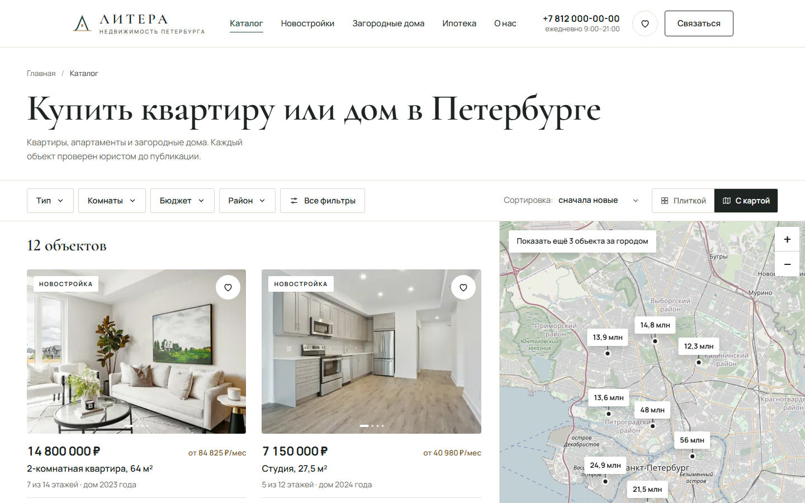
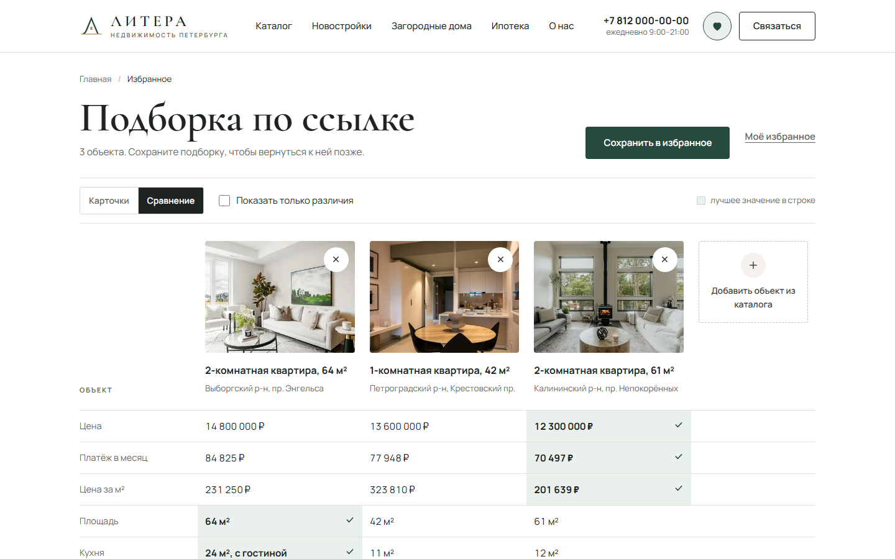

# «Литера»: каталог агентства недвижимости на Nuxt

Концепт для портфолио: многостраничный каталог. Многостраничные сайты я сопровождал на заказах,
здесь собрал такой сайт с нуля на Nuxt. Агентство, объекты, цены, агенты и телефоны вымышлены,
заявки никуда не отправляются.

**Демо:** https://karelin-dev.github.io/realty-catalog/


| Каталог с картой | Страница объекта |
|---|---|
|  |  |

| Сравнение в избранном | Мобильная версия |
|---|---|
|  |  |

## Задача

Каталог, в котором покупатель сам подбирает квартиру по бюджету, району и платежу по ипотеке,
сравнивает варианты и записывается на просмотр. Каждый объект находится в поиске отдельной
страницей со своим заголовком и превью.

## Что сделано

- **Дизайн с нуля.** Название, логотип, палитра в стиле «доступный премиум», шрифты
  Cormorant Garamond и Manrope, макеты десктопа и мобильной версии. Вёрстка повторяет макет.
- **Многостраничный сайт на Nuxt со статической генерацией.** Главная, каталог, избранное
  и 12 страниц объектов собираются в готовый HTML (`nuxt generate`) и публикуются на GitHub Pages.
  У каждого объекта свой адрес, заголовок, описание, превью для соцсетей и разметка
  schema.org для поисковиков. Неизвестный адрес ведёт на страницу 404.
- **Каталог.**
  - Фильтры: тип, новостройка или вторичка, комнаты, бюджет, площадь, районы,
    пешком до метро, не первый этаж, с ремонтом, парковка. Сортировка по новизне, цене и площади.
  - Бюджет можно задать ценой или платежом в месяц: каталог пересчитывает его
    тем же калькулятором, что и на странице объекта.
  - Фильтры хранятся в адресе страницы: подборку можно отправить ссылкой,
    она откроется с теми же условиями. Активные фильтры видны чипами, каждый сбрасывается отдельно.
  - Пустая выдача не тупик: сайт подсказывает, какое условие ослабить
    и сколько объектов тогда найдётся, и меняет его в один клик.
  - Карта рядом со списком (Leaflet и OpenStreetMap): цены на метках, наведение
    на карточку подсвечивает метку, клик по метке прокручивает к объекту в списке.
    На телефоне карта открывается на весь экран, внизу карточка выбранного объекта.
- **Страница объекта.** Мозаика фото и просмотр на весь экран (стрелки, клавиатура,
  свайп, миниатюры), характеристики, описание, что рядом, карта, ипотечный
  калькулятор с ценой объекта, похожие объекты, агент и закреплённый блок с ценой.
- **Запись на просмотр.** Дни на неделю вперёд, свободное время, формат: в квартире
  или по видеосвязи. Маска телефона и проверка полей с понятными ошибками.
  После записи можно скачать файл `.ics` и добавить просмотр в календарь.
  Занятость детерминированная (хеш «объект + дата + время»), расписание вынесено
  в чистые функции (`getSlots`, `getDays`): их легко заменить запросом к API.
- **Ипотечный калькулятор.** Аннуитетный платёж, цена, первоначальный взнос, срок,
  ставка 6, 12, 18 % или своя. С главной кнопка ведёт в каталог с фильтром
  «платёж до N ₽ в месяц».
- **Избранное и сравнение.** Хранится в браузере (`localStorage`), счётчик в шапке.
  Сравнение таблицей с отметкой лучшего значения в строке и режимом «только различия».
  Подборкой можно поделиться ссылкой: у получателя она откроется отдельно, с кнопкой
  «Сохранить в избранное». Очистка с возможностью отменить.
- **Доступность.** Диалоги с ловушкой фокуса, закрытием по Esc и возвратом фокуса,
  свои выпадающие списки по паттерну ARIA combobox (стрелки, Home, End, Esc, поиск
  по первым буквам), видимый фокус, подписи у всех полей и кнопок-иконок, `aria-live` у счётчиков
  и уведомлений, контраст по WCAG AA, `prefers-reduced-motion`, ссылка «Перейти к содержимому».
- **Производительность.**
  - Стили встроены в HTML, лишних запросов при открытии страницы нет.
  - Свои шрифты, разбитые на кириллицу и латиницу, с подобранными запасными шрифтами:
    текст не прыгает, когда шрифт догружается.
  - Фото в WebP в 2–3 размерах с `srcset`, ленивая загрузка, размеры у всех картинок.
    Остальные фото в карточке грузятся, только когда на неё наводят курсор или начинают листать.
  - Блоки ниже первого экрана оживают (гидратация), только когда до них доскроллили.
    Leaflet грузится только там, где есть карта.

**Lighthouse на GitHub Pages:** мобильная версия: главная 99 / 100 / 100 / 100,
каталог 92, страница объекта 97, избранное 99 (производительность, доступность,
Best Practices, SEO; производительность по медиане трёх замеров, остальные три
показателя 100 на всех страницах). Десктоп 100 / 100 / 100 / 100 на всех страницах.

## Стек

Nuxt 4 (Vue 3, `<script setup>`, Composition API), JavaScript, статическая генерация,
Leaflet и тайлы OpenStreetMap. CSS без фреймворков: переменные в `base.css`
и стили внутри компонентов. Шрифты из Fontsource, фото подготовлены скриптом
на Python (Pillow). Фото с Unsplash, авторы в [CREDITS.md](CREDITS.md).

## Запуск

```bash
npm install
npm run dev        # сервер разработки на http://localhost:3004
npm run generate   # сборка в docs/, оттуда сайт публикует GitHub Pages
npm run preview    # проверка сборки на http://localhost:3005/realty-catalog/
```

## Структура

```
app/
  pages/
    index.vue            # главная: поиск, подборки, карта районов, калькулятор, агенты
    catalog/index.vue    # каталог: фильтры, список, карта
    catalog/[slug].vue   # страница объекта
    favorites.vue        # избранное и сравнение
  components/            # карточка, фильтры, карта, калькулятор, запись, галерея, диалоги
  composables/           # избранное, фильтры из адреса страницы, уведомления
  data/properties.js     # объекты, районы, метро, агенты
  utils/
    filters.js           # фильтры, чипы, подсказка для пустой выдачи
    mortgage.js          # ипотечный калькулятор
    booking.js           # дни и время просмотров, файл .ics
    forms.js             # маска телефона, проверка полей, отправка заявок
    format.js            # цены, площади, склонения
  assets/                # стили и шрифты
public/img/              # фото в WebP
scripts/                 # подготовка фото и шрифтов, копирование сборки в docs/
docs/                    # собранный сайт для GitHub Pages
```

## Подключение отправки заявок

В `app/utils/forms.js` укажите адрес в `LEAD_ENDPOINT`. Запись на просмотр отправит POST с JSON:

```json
{
  "form": "viewing",
  "object": "petrogradsky-3k",
  "date": "2026-10-30",
  "time": "12:00",
  "format": "в квартире",
  "name": "Ирина",
  "phone": "+7 (916) 123-45-67",
  "page": "https://karelin-dev.github.io/realty-catalog/catalog/petrogradsky-3k",
  "createdAt": "2026-10-28T09:12:44.512Z"
}
```

Форма подбора на главной отправляет `"form": "selection"`, имя, телефон и бюджет.
Пока `LEAD_ENDPOINT` не задан, заявка выводится в консоль браузера.

## Автор

Иван Карелин, [github.com/karelin-dev](https://github.com/karelin-dev)
